# Spotify · Shadowrocket

[简体中文](spotify-NoAD.md) | English

[Back to plugin-hub](../../../README.en.md)

# Listening to Spotify on iOS (archived guide)

This guide was assembled from material available online, with adjustments along the way. It documents the setup process to make it easier to follow and is not a commercial project.

This is an archived guide. For the current setup instructions, see [Shadowrocket configuration](../configuration.en.md). Both language editions share the original Chinese screenshots.

> **Links used in this guide (press and hold to copy)**
>
> Link 1: `https://raw.githubusercontent.com/Yang-SyZng/plugin-hub/main/ios/shadowrocket/spotify-NoAD.en.module`
>
> Link 2: `https://johnshall.github.io/Shadowrocket-ADBlock-Rules-Forever/lazy_group.conf`
>
> Link 3: `https://raw.githubusercontent.com/blackmatrix7/ios_rule_script/master/rule/Loon/Spotify/Spotify.list`

Forked from [@app2smile](https://github.com/app2smile)

## Installing the module

**Make sure your proxy connection is already available before starting.**

### 1. Create the module — preparation

Open the Config tab at the bottom and tap Modules.

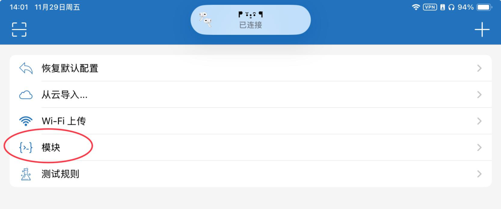

**At the time this guide was written, a Shadowrocket update prevented the “+” button in the Modules screen from importing a copied GitHub raw URL directly, so the guide used a manual method.**

Tap Create Module.

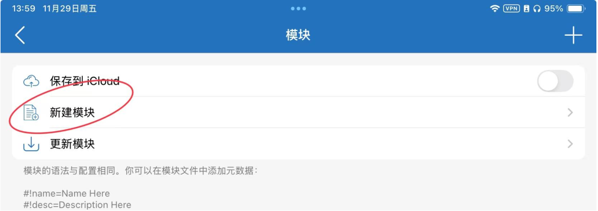

The following editor appears.

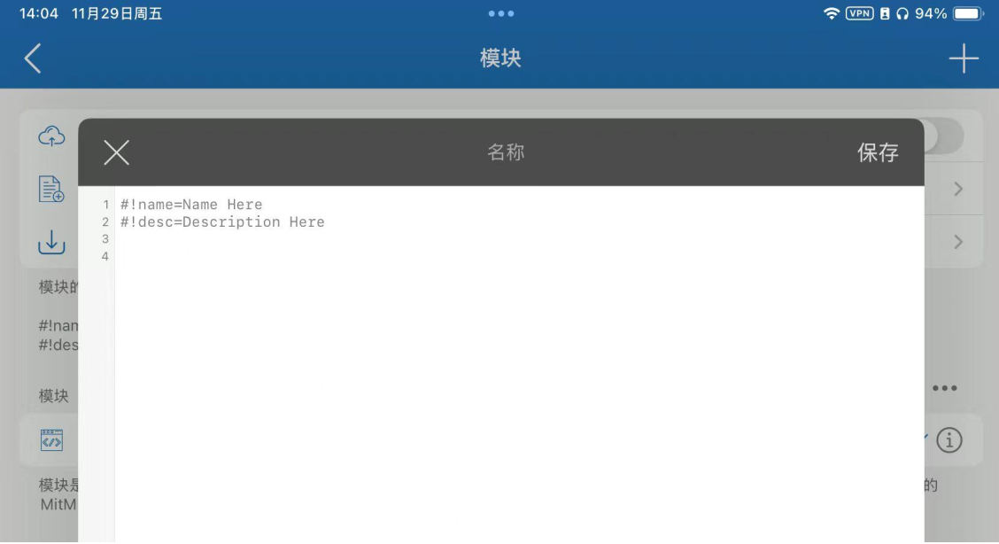

**Clear the existing content:**

`#!name=Name Here`

`#!desc=Description Here`

---

### 2. Import the module

> Link 1: `https://raw.githubusercontent.com/Yang-SyZng/plugin-hub/main/ios/shadowrocket/spotify-NoAD.en.module`

## Direct import later appeared to work again

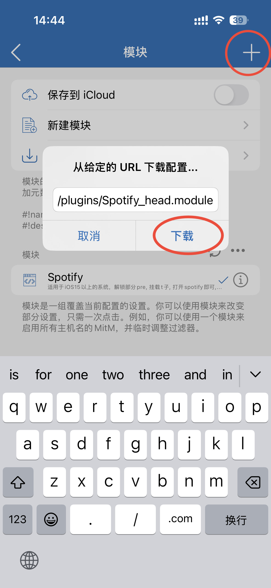

If direct import still does not work, the original manual steps are preserved below.

~~Open the URL in Safari or another browser.~~

~~Select all and copy.~~

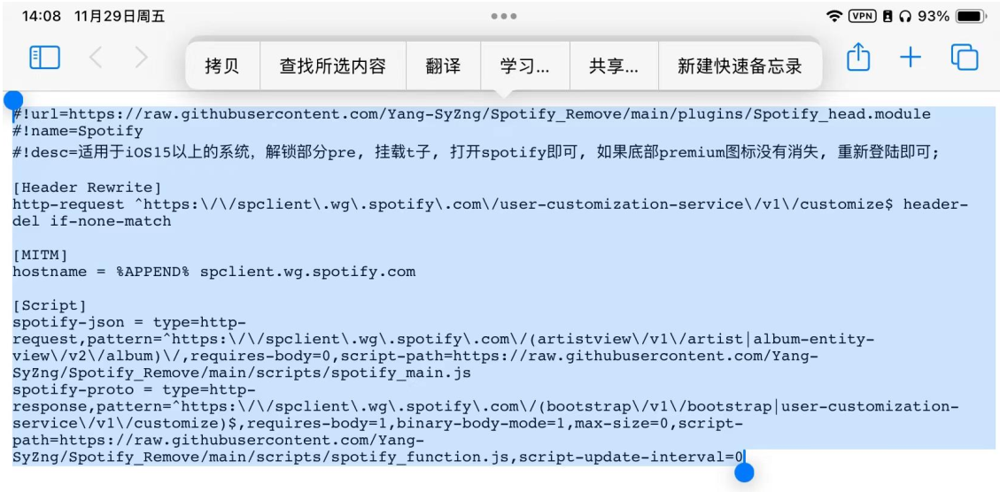

~~Paste the contents into Shadowrocket and save.~~

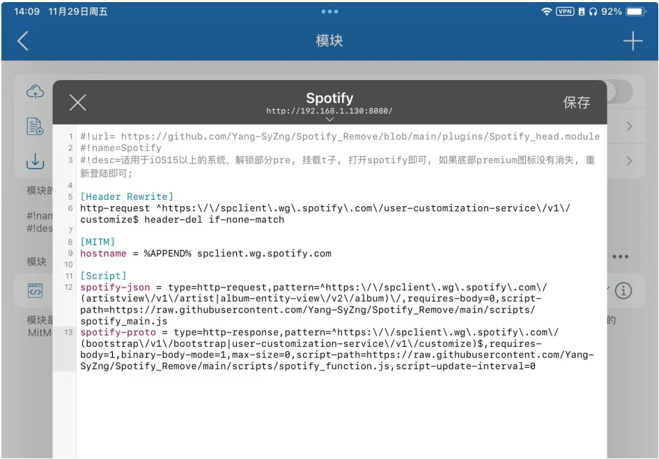

~~The module may download automatically after saving and display a success message.~~

~~If it reports a failure, tap the circled control to download the script again.~~

~~The original guide suggested checking each download control to make sure it had completed.~~

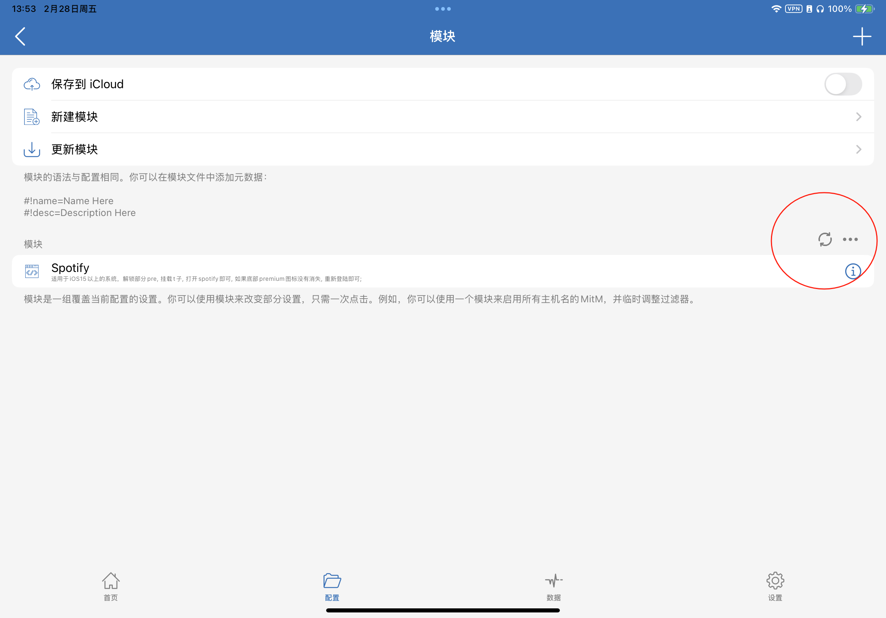

~~The module has now been imported.~~

---

### 3. Import a configuration file

Return to Config and tap “+” in the upper-right corner.

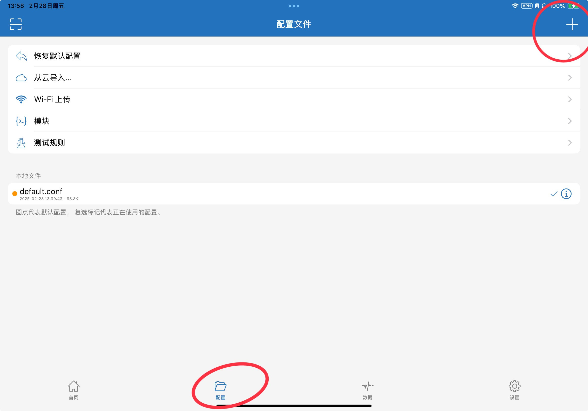

Paste the following URL and download the configuration.

> Link 2: `https://johnshall.github.io/Shadowrocket-ADBlock-Rules-Forever/lazy_group.conf`

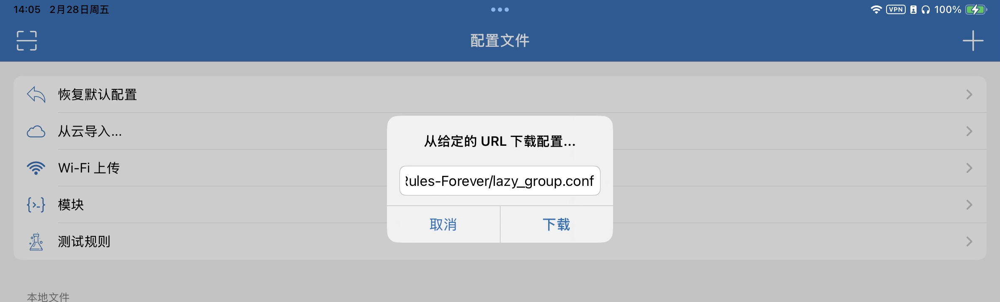

Once lazy-group.conf appears, press and hold it and select Use Configuration. The orange selection dot should appear on that row.

---

> Why use this configuration?
>
> The original guide kept the proxy connected while using the Spotify client configuration. Some domestic apps or websites could then load slowly. This routing configuration sends domestic traffic directly and routes other traffic according to its rules.
>
> For other configurations, see [Shadowrocket-ADBlock-Rules-Forever](https://github.com/Johnshall/Shadowrocket-ADBlock-Rules-Forever), maintained by @Johnshall.

---

### 4. Install and trust the certificate

Tap the information (“i”) button next to the selected configuration.

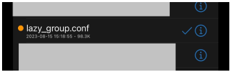

Tap HTTPS Decryption.

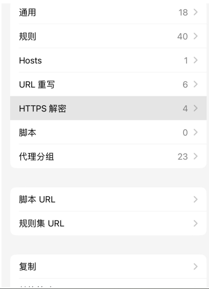

Enable HTTPS Decryption.

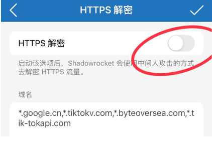

Tap Generate New CA Certificate and confirm the same action in the dialog.

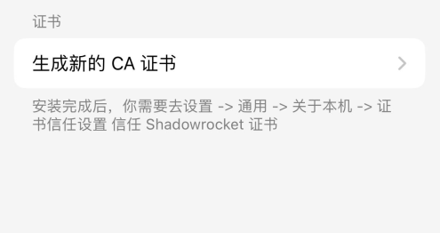

The certificate controls should now appear. Tap Install Certificate.

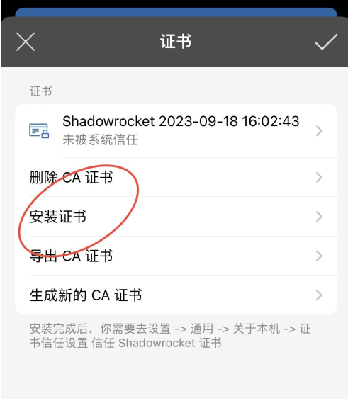

Allow the profile download.

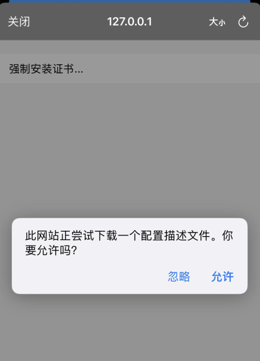

Leave Shadowrocket and open iOS Settings. Tap Profile Downloaded near the top, or open General → VPN & Device Management and find the downloaded profile.

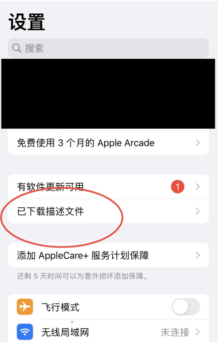

Open the profile and tap Install in the upper-right corner. Complete installation.

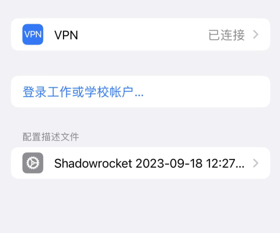

Open Settings → General → About, then scroll down to Certificate Trust Settings.

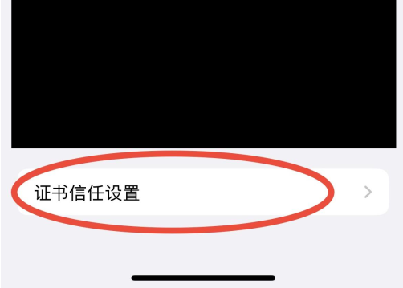

Enable trust for the certificate.

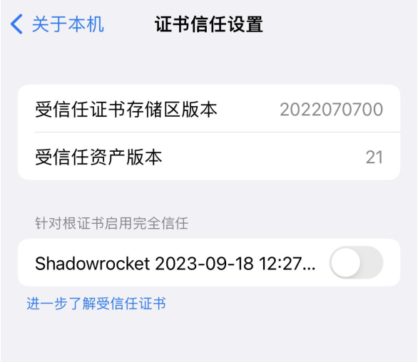

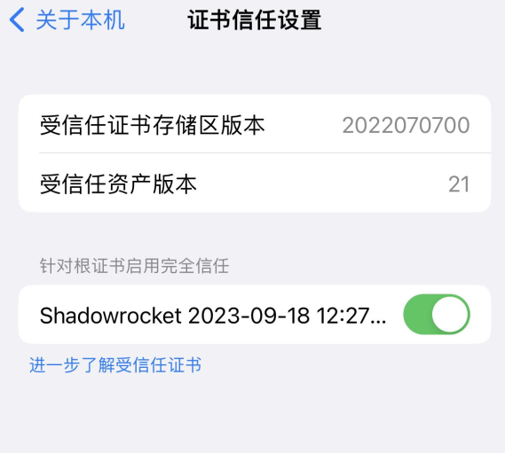

Return to Shadowrocket and confirm that the certificate is shown as trusted by the system.

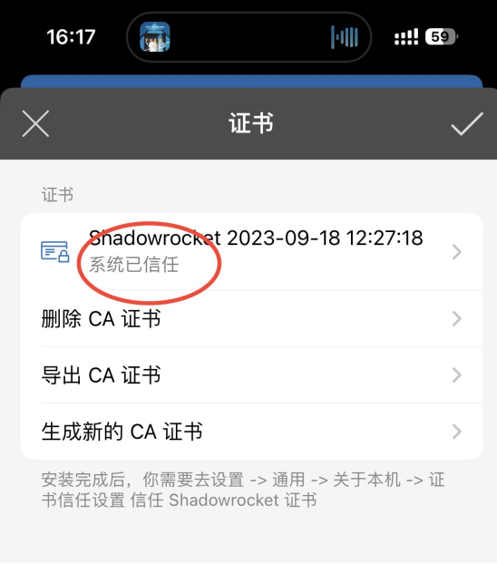

---

### 5. Add Spotify routing rules, if needed

Tap the information (“i”) button next to the selected configuration.

**Search for “spotify”. If Spotify rules are already present, skip this step.**

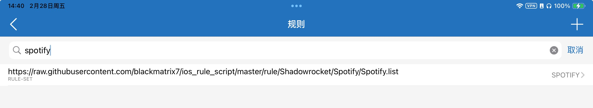

If there are no Spotify rules, tap Rules.

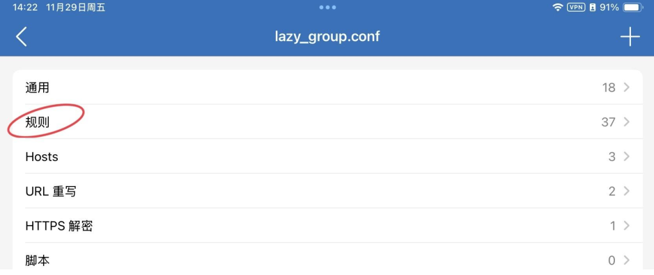

Tap “+” in the upper-right corner.

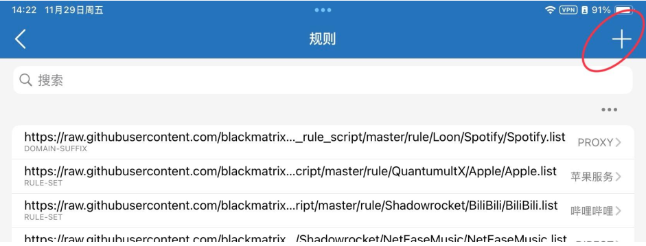

The original guide pasted the following rule-list URL into the Domain field, left the other options at their defaults, and saved.

> Link 3: `https://raw.githubusercontent.com/blackmatrix7/ios_rule_script/master/rule/Loon/Spotify/Spotify.list`

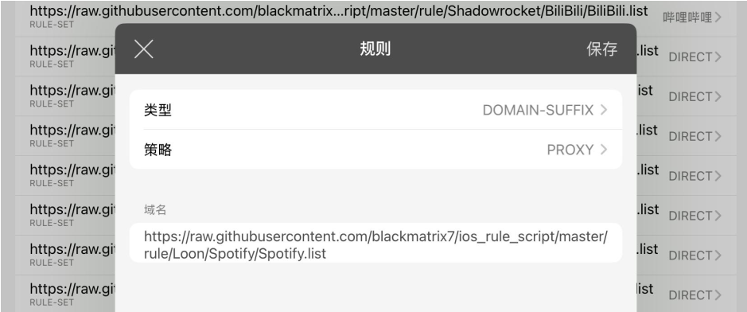

Return to the previous screen after saving.

### Shadowrocket setup is complete; reopen Spotify
